# Configuración de Zoho CRM – Proyecto Cielum (parte 6)

Este documento registra cómo quedó configurada la cuenta de prueba de Zoho CRM: leads, campo personalizado, vista, workflow, Self Client y la función Deluge.

> Las capturas van en la carpeta `capturas/`. Donde dice **📸** hay que pegar la imagen con el nombre indicado.

---

## 1. Cuenta de prueba (básico)

- Cuenta creada en [zoho.com/crm](https://www.zoho.com/crm/) con la edición de prueba gratuita.
- Centro de datos: **US** (`accounts.zoho.com` / `www.zohoapis.com`).
- Organización: *Cielum Pruebas*.

📸 `capturas/01-cuenta.png`: pantalla de inicio del CRM con el nombre de la organización.

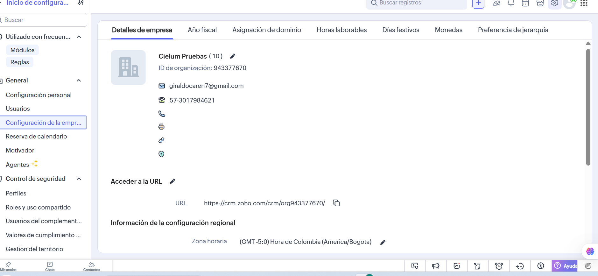

---

## 2. Leads ficticios (básico)

### 2.1 Creados a mano

Se crearon leads desde **Leads → Crear lead** con nombre, empresa, correo, teléfono, ciudad y **Origen Cielum**.

📸 `capturas/02-lead-manual.png`: formulario de un lead creado a mano.

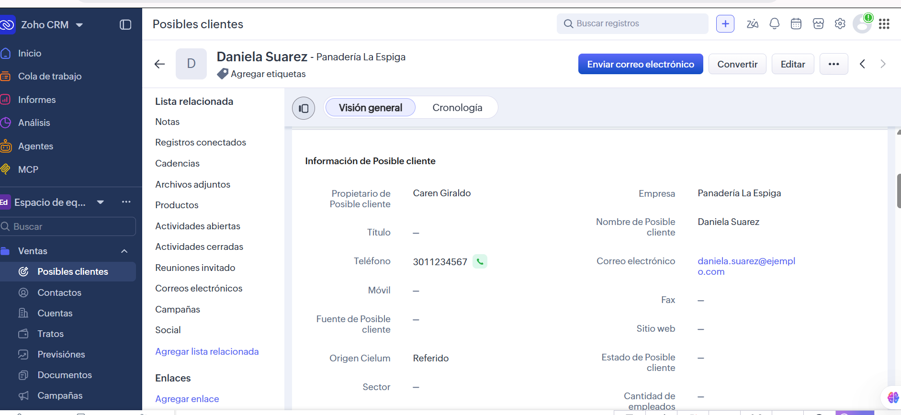

### 2.2 Importados por CSV

Archivo: [`leads-importacion.csv`](leads-importacion.csv) (10 leads ficticios con correos `@ejemplo.com`).

Pasos: **Leads → ⋯ → Importar leads → Desde archivo** → subir el CSV → revisar el mapeo de columnas:

| Columna del CSV | Campo de Zoho |
|---|---|
| First Name | Nombre |
| Last Name | Apellidos |
| Company | Empresa |
| Email | Correo electrónico |
| Phone | Teléfono |
| City | Ciudad |
| Lead Source | Fuente de Lead |
| Origen Cielum | Origen Cielum (campo personalizado) |

> Crea primero el campo **Origen Cielum** (sección 3) para que la última columna se pueda mapear.

📸 `capturas/04-leads-importados.png`: listado con los 10 leads.

> La captura del mapeo no se guardó en el momento de la importación; la evidencia de que funcionó es el listado de leads importados (captura 04).

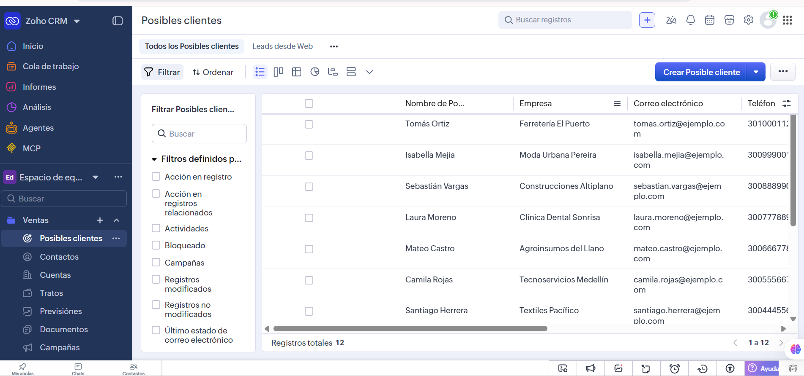

---

## 3. Campo personalizado "Origen Cielum" (intermedio)

**Configuración → Personalización → Módulos y campos → Leads → Diseño estándar** → arrastrar un campo **Lista de selección**.

| Propiedad | Valor |
|---|---|
| Etiqueta | Origen Cielum |
| Tipo | Lista de selección |
| Opciones | Web, Referido, Evento |
| Nombre de API | `Origen_Cielum` |

El nombre de API se ve en **Módulos y campos → Leads → Campos**. Es el que usan la API y Postman.

📸 `capturas/05-campo-origen.png`: configuración del campo con sus 3 opciones.

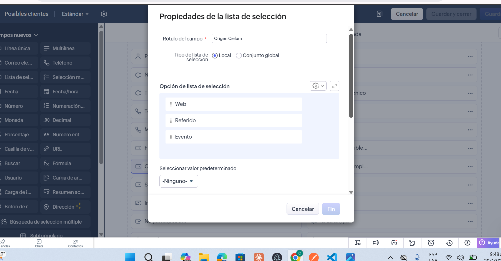

---

## 4. Vista filtrada (intermedio)

**Leads → menú de vistas → Crear vista**.

| Propiedad | Valor |
|---|---|
| Nombre | Leads desde Web |
| Criterio | Origen Cielum **es** Web |
| Columnas | Nombre, Empresa, Correo, Ciudad, Origen Cielum, Hora de creación |

📸 `capturas/06-vista-config.png`: criterio de la vista.
📸 `capturas/07-vista-resultado.png`: vista mostrando solo leads con origen Web.

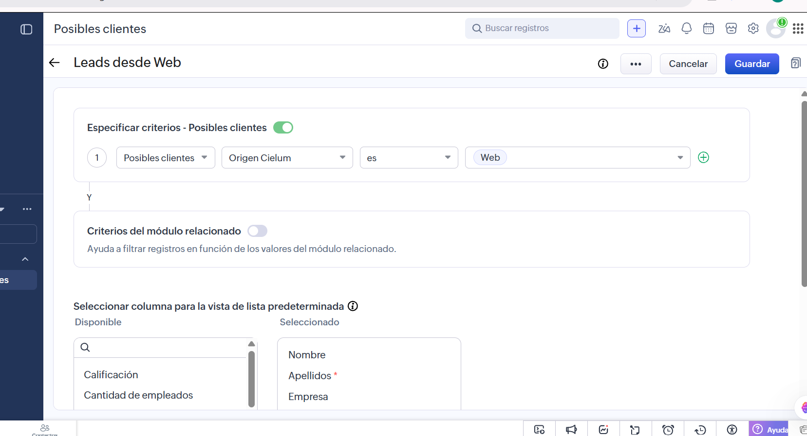
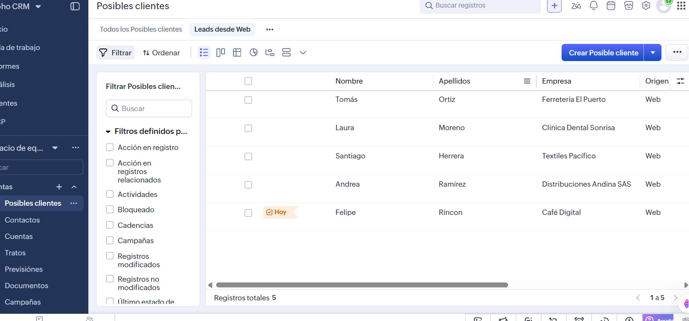

---

## 5. Workflow: tarea al crear lead con origen Web (intermedio)

**Configuración → Automatización → Reglas de flujo de trabajo → Crear regla**.

| Propiedad | Valor |
|---|---|
| Módulo | Leads |
| Nombre | Tarea para leads Web |
| Cuándo | Al crear un registro |
| Condición | Origen Cielum **es** Web |
| Acción instantánea | **Tarea** |

Configuración de la tarea:

| Campo | Valor |
|---|---|
| Asunto | Contactar lead que llegó por la web |
| Vence | 1 día después de la fecha de activación de la regla |
| Prioridad | Alta |
| Asignada a | Propietario del registro |

**Prueba:** se creó un lead con origen *Web* y apareció la tarea en **Actividades → Tareas** y en la ficha del lead. Al crear uno con origen *Referido*, no se generó tarea.

📸 `capturas/08-workflow-regla.png`: regla con condición y acción.
📸 `capturas/09-workflow-tarea.png`: tarea creada automáticamente en el lead.

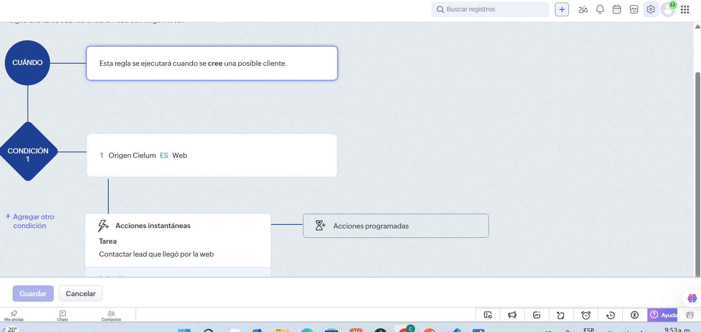
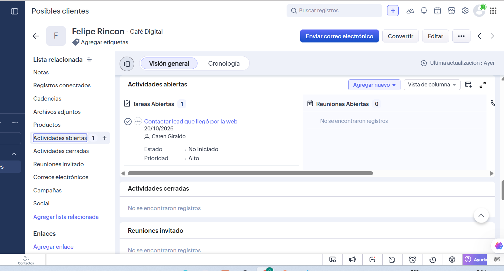

---

## 6. API: Self Client y tokens (avanzado)

### 6.1 Crear el Self Client

1. Ir a [api-console.zoho.com](https://api-console.zoho.com/) → **Add Client → Self Client → Create**.
2. Copiar **Client ID** y **Client Secret** (pestaña *Client Secret*).

📸 `capturas/10-self-client.png`: Self Client creado (**tapa el Client Secret** antes de la captura).

### 6.2 Generar el grant code

En el Self Client → pestaña **Generate Code**:

| Campo | Valor |
|---|---|
| Scope | `ZohoCRM.modules.ALL,ZohoCRM.settings.ALL,ZohoCRM.users.READ` |
| Time Duration | 10 minutes |
| Description | Postman Cielum |

El código dura pocos minutos y **solo sirve una vez**.

### 6.3 Cambiar el grant code por tokens (Postman)

1. Importar en Postman `postman/zoho-crm.postman_collection.json` y `postman/zoho-crm.postman_environment.json`.
2. Seleccionar el entorno **zoho-crm** y llenar en *Current value*: `client_id`, `client_secret` y `grant_code`.
3. Ejecutar **OAuth → 1. Generar tokens (grant code)**. El script guarda `access_token`, `refresh_token`, `api_domain` y la hora de vencimiento.

| Token | Duración | Uso |
|---|---|---|
| access_token | 1 hora | Va en cada petición: `Authorization: Zoho-oauthtoken <token>` |
| refresh_token | No vence (hasta revocarlo) | Pide un access_token nuevo sin volver a generar código |

### 6.4 Renovación automática

La colección tiene un **script de pre-request** que, antes de cada petición:

1. Revisa si el `access_token` falta o vence en menos de 1 minuto.
2. Si es así, llama a `/oauth/v2/token` con `grant_type=refresh_token`.
3. Guarda el token nuevo y su vencimiento, y continúa con la petición original.

Por eso se puede trabajar horas sin regenerar nada a mano.

### 6.5 Peticiones de la colección

| Petición | Método y ruta | Resultado |
|---|---|---|
| Crear lead | `POST /crm/v8/Leads` | Crea el lead (origen Web) y guarda `lead_id`. |
| Consultar lead por id | `GET /crm/v8/Leads/{{lead_id}}` | Trae el lead creado. |
| Listar leads | `GET /crm/v8/Leads?fields=...` | Lista con los campos pedidos. |
| Actualizar lead | `PUT /crm/v8/Leads/{{lead_id}}` | Cambia teléfono, ciudad y origen. |
| Buscar por email | `GET /crm/v8/Leads/search?email=...` | Encuentra el lead por correo. |
| Buscar por Origen Cielum | `GET /crm/v8/Leads/search?criteria=(Origen_Cielum:equals:Web)` | Filtra por el campo personalizado. |

📸 `capturas/11-postman-crear.png`: respuesta 201 al crear el lead.
📸 `capturas/12-postman-buscar.png`: respuesta de la búsqueda.

> **Seguridad:** la colección y el entorno del repo **no tienen tokens reales**. Los valores se ponen solo en *Current value* de Postman, que no se exporta. Nunca subas un entorno exportado con valores.

---

## 7. Función Deluge (reto)

Al **crear un Deal**, una función copia el nombre y el monto del Deal a los campos *Último Deal* y *Monto último Deal* del Contact asociado.

- Código: [`deluge/actualizar_contacto_desde_deal.dg`](deluge/actualizar_contacto_desde_deal.dg)
- Documentación, instalación y pruebas: [`deluge/README.md`](deluge/README.md)

### Estado: escrita y documentada, pendiente de instalar

La función **no se pudo instalar en la cuenta**: en *Configuración → Automatización → Acciones* no existe la pestaña **Funciones** (solo aparecen Notificaciones de correo, Tareas, Actualizaciones de campos, Webhooks y Zoho Flow), y tampoco aparece en el Espacio para desarrolladores. Al intentar crearla desde el workflow, Zoho devolvió error 500 (ver sección 8.1).

Esto indica que **la edición de la cuenta de prueba no incluye funciones Deluge**. En una cuenta con edición Enterprise (o su prueba gratuita) se instala siguiendo [`deluge/README.md`](deluge/README.md).

**Lo que sí quedó hecho:**

| Parte | Evidencia |
|---|---|
| Campos *Ultimo Deal* (`Ultimo_Deal`) y *Monto ultimo Deal* (`Monto_ultimo_Deal`) en Contacts | `capturas/21-campos-contacts.png` |
| Código de la función, comentado | `deluge/actualizar_contacto_desde_deal.dg` |
| Documentación: instalación, workflow y pruebas | `deluge/README.md` |
| Prueba de la misma lógica por API: se creó un Deal asociado a un contacto y luego se actualizaron los dos campos del contacto con `PUT /Contacts/{id}` | Postman: *Crear deal* (201) y *Actualizar contacto* (200) |

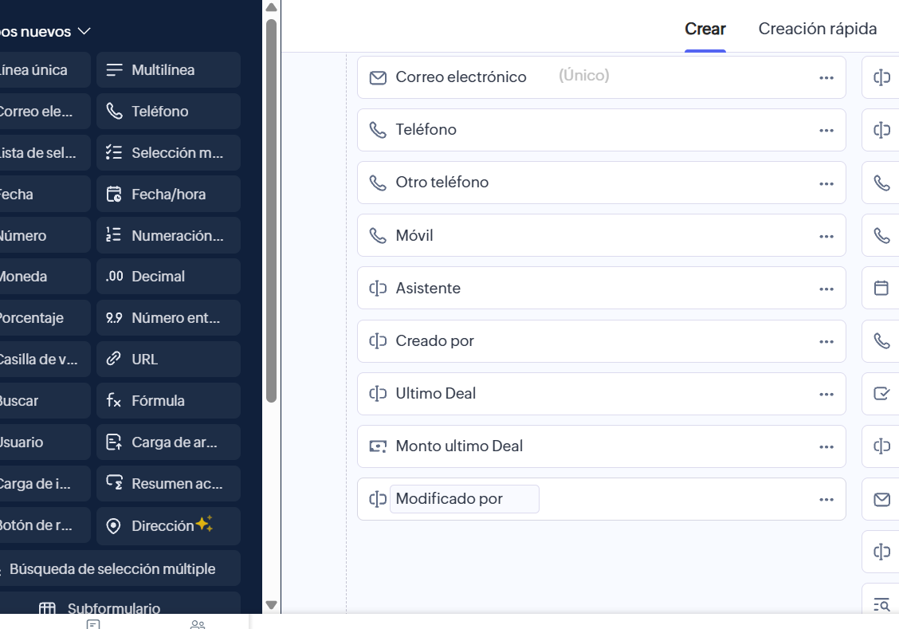

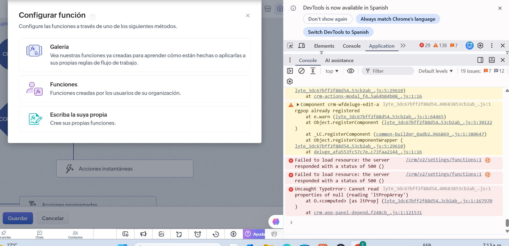

---

## 8. Problemas que tuvimos y cómo se solucionaron

En esta sección se explica, en palabras sencillas, cada problema que apareció durante la configuración y qué se hizo para resolverlo. Sirve como guía por si alguien más se encuentra con lo mismo.

### 8.1 Zoho no dejaba crear la función Deluge

**Qué pasó:** al intentar crear la función desde el workflow, la ventana de "Configurar función" se quedaba trabada y no permitía escribir el código. En la consola del navegador aparecía un error 500.

**Por qué:** el error 500 quiere decir que **el problema era del servidor de Zoho**, no de algo que hiciéramos mal. Puede deberse a una falla temporal de Zoho o a que la edición de la cuenta tiene limitaciones para funciones.

**Cómo se manejó:** se dejó la función para el final y se siguió con lo demás. El código ya está listo en [`deluge/actualizar_contacto_desde_deal.dg`](deluge/actualizar_contacto_desde_deal.dg). Las alternativas para volver a intentarlo son: crear la función desde **Configuración → Automatización → Acciones → Funciones** (y no desde el workflow), recargar la página, o probar en una ventana de incógnito.

📸 `capturas/15-error-funcion.png`


### 8.2 El nombre del campo del monto estaba mal escrito en el código

**Qué pasó:** el código decía `Monto_Ultimo_Deal` (con "U" mayúscula), pero en Zoho el campo se llama `Monto_ultimo_Deal` (con "u" minúscula).

**Por qué importa:** Zoho distingue mayúsculas de minúsculas en los nombres de los campos. Si el nombre no es exacto, la función no encuentra el campo y no lo llena.

**Cómo se solucionó:** se revisó el nombre real en Zoho y se corrigió en el código y en el README.


### 8.3 La colección de Postman no aparecía

**Qué pasó:** se buscaba la variable `grant_code` y no aparecía por ningún lado.

**Por qué:** la colección no se había importado en Postman todavía, así que sus variables no existían.

**Cómo se solucionó:** se importó el archivo de la colección con **Import** (Ctrl + O) y luego se abrieron sus variables en la pestaña **Variables** de la colección.

### 8.4 Postman avisó "Secrets Detected"

**Qué pasó:** apareció una alerta diciendo que había un "secreto" (una clave) guardada en la colección.

**Por qué:** era una **falsa alarma**. Postman vio el texto `Zoho-oauthtoken {{access_token}}` y pensó que era una clave real, pero en realidad era solo el nombre de una variable, no el token.

**Cómo se solucionó:** se ignoró la alerta. No se usó "Secure All", porque eso cambia la configuración y podía dañar la autenticación.

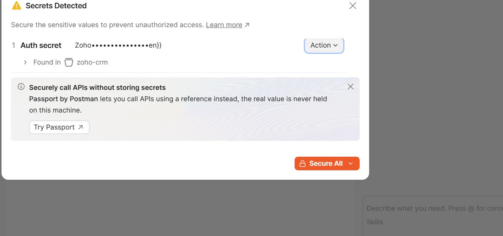

### 8.5 Las peticiones no tenían dirección (URL)

**Qué pasó:** al abrir "Generar tokens" y "Listar leads", el espacio de la dirección estaba vacío.

**Por qué:** la colección se había armado sin las direcciones completas.

**Cómo se solucionó:** se escribió la dirección correcta en cada una. Por ejemplo, para pedir los tokens: `https://accounts.zoho.com/oauth/v2/token`.

### 8.6 Error "ENOTFOUND {{base_url}}"

**Qué pasó:** Postman no podía enviar la petición y mostraba ese mensaje.

**Por qué:** la dirección usaba una variable llamada `base_url` que **no existía**. Es como mandar una carta a "la dirección de siempre" sin haber escrito nunca cuál es esa dirección. Además, la petición no estaba guardada dentro de la colección, así que no podía ver sus variables.

**Cómo se solucionó:** se guardó la petición dentro de la colección `zoho-crm` y se usó la dirección completa `https://www.zohoapis.com/crm/v6/...`.

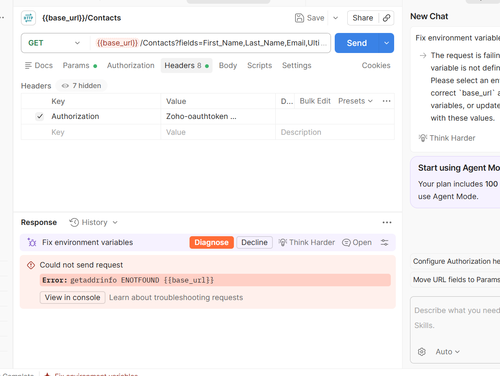

### 8.7 Error "INVALID_TOKEN" (token vencido)

**Qué pasó:** peticiones que antes funcionaban empezaron a fallar.

**Por qué:** el token de acceso funciona como una **pulsera de entrada que dura solo 1 hora**. Pasado ese tiempo, Zoho ya no la acepta.

**Cómo se solucionó:** se ejecutó **OAuth → 2. Renovar access_token**, que usa el `refresh_token` (una clave de larga duración) para conseguir un token nuevo sin repetir todo el proceso. El token nuevo se pegó en la variable `access_token`.

### 8.8 Error "AUTHENTICATION_FAILURE" aunque el token era bueno

**Qué pasó:** "Listar leads" funcionaba, pero "Listar contactos", "Crear contacto" y "Actualizar contacto" fallaban con el mismo token.

**Por qué:** Postman tiene **dos lugares** para poner el token: la pestaña **Authorization** y la pestaña **Headers**. Las peticiones nuevas se copiaron de otras y venían con la pestaña Authorization configurada para "heredar" un token viejo de la colección. Cuando hay dos tokens, Postman usa el de la pestaña Authorization, así que a Zoho le llegaba el viejo y lo rechazaba. En "Crear contacto", además, faltaba el token en Headers.

**Cómo se solucionó:**
1. En la pestaña **Authorization** se escogió **No Auth**, para que Postman no mande el token viejo.
2. En **Headers** se dejó una sola línea: `Authorization` = `Zoho-oauthtoken {{access_token}}`.

**Lección:** al copiar una petición, revisar siempre esas dos pestañas.

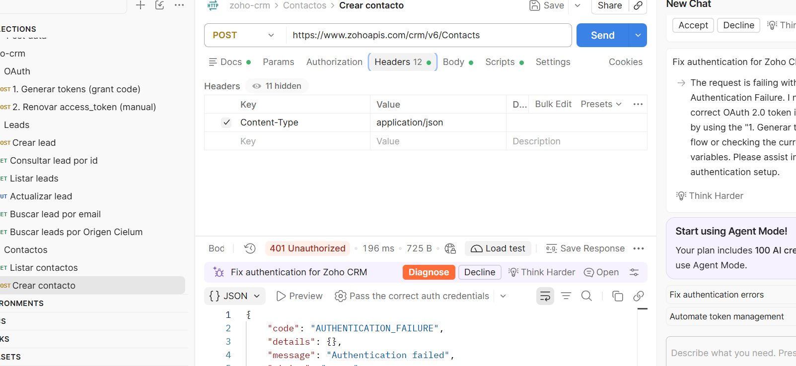

### 8.9 "204 No Content" al listar contactos

**Qué pasó:** la petición respondió 204 y no mostró nada.

**Por qué:** **no era un error**. Significa "todo bien, pero no hay datos": todavía no existía ningún contacto en el CRM.

**Cómo se solucionó:** se creó un contacto con "Crear contacto" y al volver a listar ya respondió 200 con el contacto.

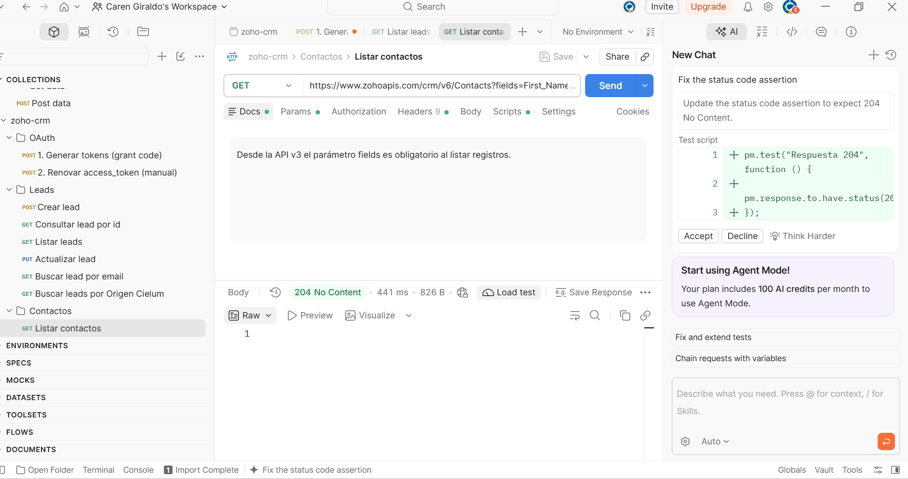

### 8.10 Error "DUPLICATE_DATA" al crear un contacto

**Qué pasó:** al volver a crear el contacto de prueba, Zoho respondió 400.

**Por qué:** Zoho **no permite dos contactos con el mismo correo**. Como el contacto ya se había creado antes, lo rechazó para evitar duplicados. Esto demuestra que la validación de Zoho funciona.

**Cómo se solucionó:** se cambió el correo por uno que se genera distinto cada vez: `prueba.{{$timestamp}}@ejemplo.com`.

📸 `capturas/16-postman-duplicado.png`

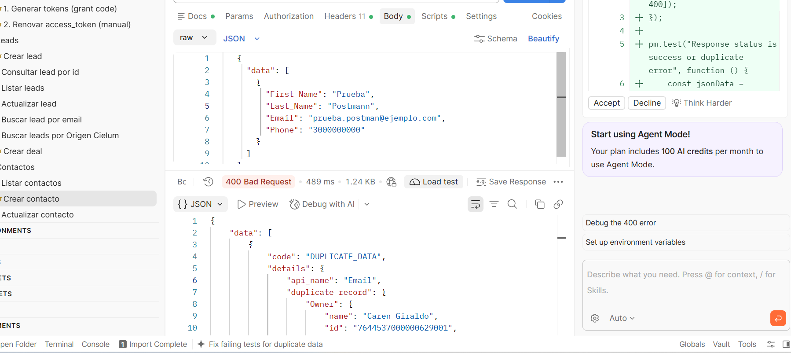

### Resumen rápido

| # | Problema | Causa en pocas palabras | Solución |
|---|---|---|---|
| 1 | No se podía crear la función | Falla del servidor de Zoho | Dejarla para el final; código ya listo |
| 2 | Nombre del campo mal escrito | Mayúscula de más | Corregir a `Monto_ultimo_Deal` |
| 3 | No aparecía la colección | No se había importado | Importarla en Postman |
| 4 | Alerta de "secretos" | Falsa alarma | Ignorarla |
| 5 | Peticiones sin URL | Colección incompleta | Escribir la URL |
| 6 | ENOTFOUND | Variable que no existía | Usar la URL completa / guardar en la colección |
| 7 | INVALID_TOKEN | Token vencido (1 hora) | Renovar el token |
| 8 | AUTHENTICATION_FAILURE | Token viejo heredado | Authorization en **No Auth** + header correcto |
| 9 | 204 No Content | No había contactos (no es error) | Crear un contacto |
| 10 | DUPLICATE_DATA | Correo repetido | Correo que cambia solo |

---

## Estructura de la carpeta

```
zoho/
├── configuracion.md                  ← este documento
├── leads-importacion.csv             ← 10 leads ficticios
├── capturas/                         ← imágenes de la configuración
├── postman/
│   ├── zoho-crm.postman_collection.json
│   └── zoho-crm.postman_environment.json   (plantilla sin tokens)
└── deluge/
    ├── actualizar_contacto_desde_deal.dg
    └── README.md
```
